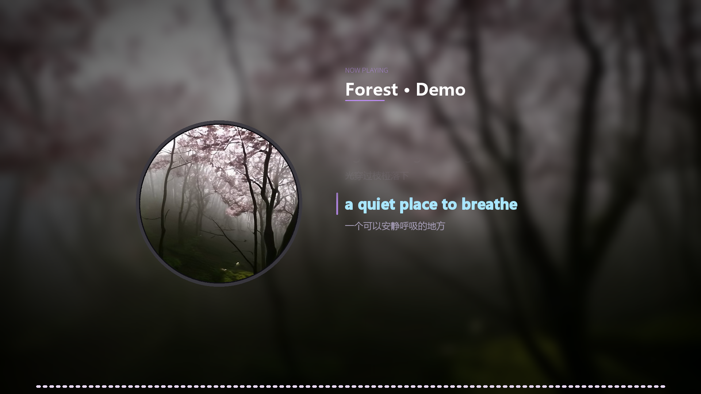

# MusViz · 音乐可视化

把一首歌 + 一张封面，做成**黑胶唱片风格的音乐可视化视频**（默认 1080p）。

自动读取 MP3 标签里的封面、标题、艺人、歌词（带时间轴的 LRC），
歌词跟着唱滚动、当前行高亮。纯 Python + ffmpeg，**CPU 渲染，不需要显卡**。

Windows / Linux 都能跑。

```
封面 → 圆盘标签（慢速旋转）    歌词 → 右侧滚动 + 中文翻译
标题 → NOW PLAYING + 曲名      音条 → 底部 96 段实时频谱
```



> 演示图用的是 AI 生成的风景素材，仓库不含任何版权音乐或封面。


## 功能

- **四种模板**：黑胶经典 / 居中歌词 / 纯文字 / 无音条
- **全参数可调**：唱片大小位置、歌词字号行距位置、标题字号位置、音条数量高度、背景模糊
- **字体与颜色**：微软雅黑 / 思源黑体 / 宋体 / 楷体 / 黑体；任意颜色，当前行可单独设高亮色
- **手拖定位**：预览区直接用鼠标拖唱片 / 歌词 / 标题
- **背景**：支持图片，也支持**视频**（mp4 / webm，逐帧解码循环播放）
- **自动读标签**：MP3 内嵌封面、标题、艺人、专辑、带时间轴的歌词
- **设置持久化**：所有参数存 `layout.json`，还能「设为默认」


## 快速开始

### Linux

```bash
git clone https://github.com/<you>/musviz.git
cd musviz
chmod +x run.sh install.sh
./install.sh      # 自动装 python / Pillow / numpy / tk / ffmpeg / 中文字体
./run.sh
```

Arch 手动：

```bash
sudo pacman -S python python-pillow python-numpy tk ffmpeg noto-fonts-cjk
pip install --user --break-system-packages tkinterdnd2
./run.sh
```

### Windows

```bat
pip install -r requirements.txt
start.bat
```

ffmpeg 需要装在 PATH，或把 `ffmpeg.exe` 放到程序目录（程序优先用同目录的）。


## 用法

1. 把 MP3 拖进窗口（图片可选，MP3 自带封面就不用拖）
2. 右侧选模板、调参数
3. 点「预览一帧」，不满意的直接拖
4. 点「生成视频」

动画细节：首尾各 1.5 / 3 秒淡入淡出；歌词换行有 0.35 秒缓动上滑，
上下边界渐隐；当前行用描边加粗 + 左侧竖条标识。


## 排版参数

| 参数 | 含义 |
|---|---|
| 唱片大小 | 圆盘半径（基准 1280 宽） |
| 唱片 X / Y | 圆心位置 |
| 歌词字号 / 行距 | 字号与行间距 |
| 歌词 X | 左对齐起点；0 或 -1 表示水平居中 |
| 标题字号 / Y | 标题大小与高度 |
| 音条数量 / 高度 | 频谱条数量与最大高度 |
| 背景模糊 | 0 = 用原图，越大越糊 |

参数实时保存到 `layout.json`。点「设为默认」把当前调好的存成个人默认，
「恢复默认」回到那份，不会冲掉成模板原样。


## 目录结构

```
app.py              界面（tkinter）
renderer.py         渲染引擎（参数化布局、视频背景、频谱）
viz.py              标签读取、音频分析、命令行版
platform_utils.py   跨平台：ffmpeg 定位、字体查找、打开文件夹
ui_widgets.py       圆角按钮
install.sh / run.sh Linux 安装与启动
start.bat           Windows 启动
```


## 性能

CPU 单线程渲染，1080p / 25fps：

| 视频时长 | 渲染耗时 |
|---|---|
| 30 秒 | ≈ 45 秒 |
| 1 分钟 | ≈ 1.5 分钟 |
| 3 分半 | ≈ 5 分钟 |

想更快：改 `renderer.py` 里 `crf`（画质换体积）、降分辨率，或把 `fps` 调到 30/60 之间合适值。


## 常见问题

**中文显示成方框**
缺中文字体。Arch：`sudo pacman -S noto-fonts-cjk`；Debian：`apt install fonts-noto-cjk`

**拖拽没反应**
需要 `tkinterdnd2`，装不上也没关系，用「选择」按钮。

**找不到 ffmpeg**
装系统 ffmpeg（`pacman -S ffmpeg`），或把可执行文件放程序目录。

**歌词不显示**
MP3 的 `USLT` 标签里要带 `[mm:ss.xxx]` 时间轴，且至少 3 行。
只有纯文本没有时间轴的话，没法对齐。


## 声明

本项目不包含任何音频、图片素材。请使用**你有权使用**的音乐和封面。
渲染出的视频版权归素材权利人所有，本项目只提供工具。


## License

MIT
